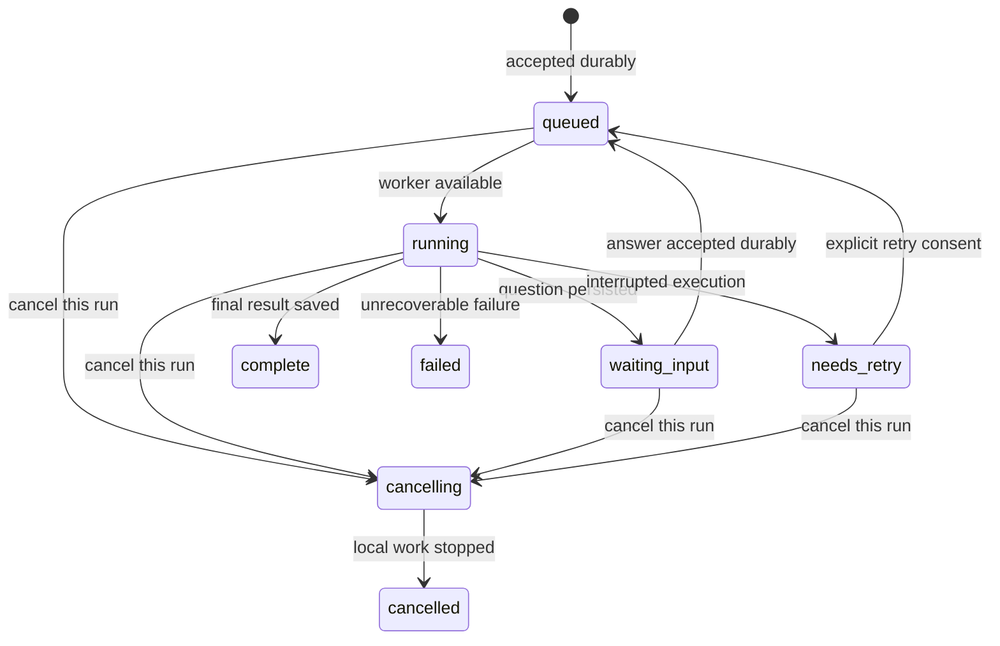

# Plan

Build a Rust command-line client named `council` for the local LLM Council backend.
Version 1 must complete a consultation without the browser: compose and refine a
question, answer interactive prompts, follow progress, inspect member answers and
reviews, and save or reopen results. Extend the existing backend where reliable
submission, durable human input, and recovery require it.

Date: 2026-11-01. Decision status: **implementation authorized**.
Implementation started with the backend contract milestone; see
[contract status](CONTRACT.md). Internal durable admission is implemented without
worker scheduling. The Rust foundation and authenticated macOS setup command now exist; public
durable run operations and consultation command integration remain unimplemented. See
[README.md](README.md). The decisions below were confirmed with the user; command spellings,
API shapes, and module boundaries are engineering proposals for implementation.

## Scope

- **In:** Rust, ordinary commands with interactive prompts, a backend on this Mac,
  Keychain authentication, the complete consultation loop, history and Markdown
  export, durable waiting, explicit retry, and cancellation of a particular run.
- **Out:** a full-screen terminal UI, remote deployment, backend process
  management, context-aware follow-up consultations, side chats, skill
  administration, synthesis-version management, and direct model-provider calls
  from Rust. Existing skill selection and optional council stages remain usable.

## Action items

- [x] Define typed consultation request/response contracts, prompt-instance
  identity, lifecycle states, and compatibility fixtures in the backend. Add a
  CLI contract version to `/api/config`; distinguish current endpoints from the
  proposed additions below.
- [ ] Add durable, idempotent run creation and lookup/history by consultation ID,
  reusing `consultation_manager.py`, `consultation_journal.py`, and `storage.py`.
  Cover lost acknowledgments, concurrent duplicates, restart, completed runs,
  and deletion before connecting the Rust client. Internal admission/receipt
  persistence is complete; public routes, execution handoff and full run snapshots
  remain pending (see [contract boundaries](CONTRACT.md)). Read-only internal
  inspection of prepared/refinement work preserves prompts and cancellation
  evidence without scheduling or claiming a complete consultation.
- [ ] Implement persistent human-input checkpoints in `langgraph_flow.py` and
  the manager. Persist the exact prompt and resume location, release the worker
  while waiting, and consume each accepted answer once. Recover uncertain model
  execution as `needs_retry`, preserving saved work. The internal refinement
  answer coordinator now consumes the first saved answer into a finite next
  continuation atomically; a revision-bound suggestion guard now persists in-flight
  work, requires explicit retry for uncertain outcomes, and saves the suggestion
  plus waiting prompt atomically. An explicitly selected OpenRouter-only adapter now
  snapshots its request settings and performs one HTTP request per attempt.
  Resolved council model limits and initial budgets are now pinned separately;
  explicit uploaded-skill content can also be archived for restart-safe reads;
  a read-only renderer can preview those exact archived bytes with explicit
  reference selections, without rereading mutable library files;
  the explicitly disabled-router path can now retain deterministic reference
  choices and exact Stage 1/3 skill blocks and reports;
  initial Stage 1 messages and per-member OpenRouter JSON bodies can now be
  pinned from those saved inputs when every model budget already fits, with no
  implicit context reduction; an explicit per-member callback guard now saves
  in-flight attempts and complete/partial responses, requires consent for uncertain
  retries and protects concurrent-member ownership; an explicitly called OpenRouter
  adapter now makes one bounded request from those saved inputs without automatic
  retries, redirects or continuations. An explicit internal manager handoff can
  now own one initial member on the existing pool without an automatic roster loop;
  exact first-continuation inputs can now be pinned separately from retained
  initial partial responses when the full continued context already fits the
  saved budget. This preparation neither dispatches nor replaces the partial;
  a separately invoked first-continuation callback guard now retains one named
  turn's chunk with isolated uncertain-work retry consent, without aggregating
  prior text or automatically starting another continuation; an explicitly called
  continuation OpenRouter adapter now sends that exact saved request using the
  shared bounded wire contract, with separate adapter identity and retry consent;
  an explicit manager handoff now owns that named first continuation on the pool,
  excluding simultaneous initial-member ownership without automatically choosing a turn;
  whole-roster read-only state now accounts for completed first continuations and
  returns all complete member results together without scheduling the next stage;
  full exact-wire/provider/skills provenance,
  worker release/resumption and other external-work boundaries remain incomplete.
- [ ] Add run-specific cancel and explicit retry operations. Protect mutations
  against stale clients and repeated requests; cancelling one run must leave
  other queued runs intact. Preserve the behavior of existing web submissions.
  **Partial:** internal prepared/refinement, initial Stage 1 and first-continuation
  runs now retain a durable cancellation
  marker and interrupt only their owned local provider tasks; late results and
  retries cannot resume cancelled work. Generic council-worker and public HTTP
  cancellation integration remain pending; this item stays open.
- [ ] Create one Cargo package under `cli/`, with a `council` binary, HTTP client,
  typed wire data, Keychain setup, and a shared monitor/resume loop. Implement
  `setup`, `ask`, and `resume` against the real backend contract first.
  **Partial:** Cargo package, parser, typed fixtures, offline validation and
  a bounded authenticated config transport and macOS Keychain setup dispatch
  exist. Native macOS verification, consultation commands and the monitor loop
  remain incomplete; the item stays open.
- [ ] Add `show`, `history`, `export`, `cancel`, and installed-skill listing.
  **Partial:** read-only `skills` now uses the existing authenticated endpoint
  and saved origin-bound credential. Consultation/result commands remain gated.
  Complete editor/file/stdin input, generic prompt rendering, clean stdout/stderr
  behavior, and JSON output. Reuse backend exports and results.
- [ ] Run the acceptance cases below with fake model responses, Rust formatting,
  Clippy, tests, and the repository's required backend/frontend checks. Exercise
  terminal input and Keychain behavior on macOS; perform an explicitly authorized
  small live consultation only after deterministic checks pass.
- [ ] Document installation with `cargo install --path cli --locked`, first-use
  setup, reconnect/cancel behavior, and recovery limits. Add Cargo checks to CI
  and review the implementation in scoped commits before publishing it.

## Confirmed decisions

| Decision | Choice and consequence |
| --- | --- |
| Language and boundary | Rust client over HTTP; execution, persistence, model routing, and provider credentials stay in the backend. |
| Experience | Ordinary commands with interactive questions. A full-screen UI is outside v1. |
| Completion criterion | Complete the whole consultation, including member-answer and peer-review inspection. A submit/final-only tool is insufficient. |
| Backend changes | Narrow changes for reliable submission and recovery are allowed. |
| Deployment | Local backend on this Mac. Remote connections are deferred. |
| Ctrl-C | Detach the CLI, leave backend work running, and print a reconnect command. |
| Backend unavailable | Show an actionable start command. The CLI does not start or manage Python. |
| Unanswered questions | Wait until answered; preserve pending questions across backend restarts. No silent timeout/skip for CLI runs. |
| Interrupted model work | Restore saved results and ask before retrying work whose outcome is unknown. No automatic repetition of potentially billed work. |
| Reopening | Inspect/export past results or resume unfinished runs. New questions are independent consultations. Context-aware follow-ups are deferred. |
| Default output | Final answer on stdout; progress on stderr; full answers/reviews through `show`. |
| Authentication | One-time hidden entry of the backend API key, stored in macOS Keychain. |
| Delivery milestone | Save and publish this plan and its decisions. Implementation follows a later review/instruction. |

## Proposed command interface

`RUN` means a consultation ID, not a conversation ID or an interactive session ID.
Print the full ID and a copyable reconnect command as soon as a run is submitted.
Commands that mutate work always name a particular run; avoid an implicit
"latest run" target that could change in another terminal.

| Command | Behavior |
| --- | --- |
| `council setup` | Ask for the backend key without echoing it, verify `/api/config`, store it in Keychain, and display the configured council. |
| `council ask "QUESTION"` | Create a fresh consultation, follow it, handle questions, then print the final answer. |
| `council ask --file question.md` | Read the question from a UTF-8 file. `council ask -` reads stdin; argument-free `ask` opens the configured editor. |
| `council ask --refine --file question.md` | Explicitly request the existing backend prompt-refinement workflow. Rust renders its questions and does not perform refinement itself. |
| `council ask --skill SKILL_ID "QUESTION"` | Select an installed skill; repeat the flag for several skills. Validate against backend limits. |
| `council ask --detach --file question.md` | Submit and return a run receipt immediately. Unanswered questions remain pending on the backend. |
| `council resume RUN` | Reattach to running work, answer a pending question, or show a completed result. If interrupted work needs retry, explain what will repeat and ask first. |
| `council show RUN` | Display the saved final answer, or current state if no final answer exists. |
| `council show RUN --stage answers` | Display individual member answers. Also support `reviews`, `negative`, `deliberation`, and `all`; report stages that did not run. |
| `council history` | List saved runs with ID, date, status, and a question/title excerpt; include unfinished work. |
| `council export RUN --output report.md` | Export the backend's existing complete Markdown evidence document. Do not overwrite an existing file without explicit consent. |
| `council cancel RUN` | Cancel this run, including a queued or paused run, without clearing its conversation's entire queue. |
| `council skills` | List selectable installed skills. Uploading, deleting, or managing skill sources is deferred. |

Provide `--json` for machine-readable command results and `--non-interactive` to
suppress terminal questions. These are output/input controls, not a separate
automation workflow or event-stream protocol.

### Input and output rules

- Accept exactly one question source. Reject empty input and enforce the backend's
  character limits before submitting; use Unicode character counts correctly.
- Display progress as stage transitions and completed-member counts. The current
  backend supplies snapshots, so do not promise token-by-token streaming.
- Render `select`, `multi_select`, `text`, and `checkbox` fields from the backend
  prompt schema. Show defaults and required fields; offer skip only when allowed.
  Longer question/refinement text can use the configured editor.
- Read questions from the controlling terminal when stdin contains a piped
  question. If no terminal is available, or `--non-interactive` is set, leave the
  run waiting, print the reconnect information to stderr, and exit with a
  needs-input result. Never invent answers or silently accept defaults.
- Default stdout contains only the final Markdown answer. An explicit detached
  submission returns its receipt instead. JSON mode emits one structured result,
  including run ID and state; progress never contaminates stdout.
- Proposed exit codes: `0` for a successful command, `1` for failure, `2` for
  invalid usage/configuration, `3` for required human input or retry approval,
  and `130` for Ctrl-C detachment. A monitoring timeout never cancels the run.
- Preserve original result text in storage/exports. Neutralize terminal control
  sequences when displaying untrusted model output, prompts, titles, or errors.
  Disable decorative terminal output when redirected and honor `NO_COLOR`.

## Backend contract

The existing backend already offers authenticated configuration, conversation
storage, queued submission, snapshot long polling, interactive field schemas,
skills, and Markdown exports. It does not yet offer the run-level reliability
contract required by the confirmed decisions.

### Proposed HTTP additions

| Operation | Proposed contract |
| --- | --- |
| Create | `PUT /api/consultations/{run_id}` with a client-generated UUID and question, optional negative prompt/skills, and explicit CLI interaction policy. Creates the associated conversation once. |
| History | `GET /api/consultations` returning run summaries from saved conversations and queued/active records, with bounded results. |
| Inspect/monitor | `GET /api/consultations/{run_id}?wait=25&cursor=...` returning a full snapshot for that exact run, including saved terminal results. |
| Answer | `PUT /api/consultations/{run_id}/prompts/{instance_id}/response` accepting the schema's answer values or an allowed skip. |
| Retry | `POST /api/consultations/{run_id}/retry` requiring the current persisted interruption/revision token after explicit consent. Repeating that action cannot start another attempt. |
| Cancel | `POST /api/consultations/{run_id}/cancel`, idempotent and scoped to the named run. |

Reuse `GET /api/config`, skill listing, and the existing conversation Markdown
export route. The run response supplies its conversation ID and assistant-message
index so the CLI can call the export route without guessing an index.

The CLI opts into persistent interaction and explicit crash recovery per run.
Support a per-run refinement request for `--refine`, using the existing refinement
engine. Model selection and optional negative/deliberation settings come from
backend configuration; arbitrary per-run model overrides are outside v1.

### Idempotency and identities

- Persist the accepted request identity and canonical payload before scheduling
  model work. The same run ID and payload return the same run, whether queued,
  running, paused, or terminal. Different payload under the same ID returns `409`.
- Coordinate creation under the backend's existing manager lock and durable
  storage. Recover partially initialized run/conversation creation without making
  another conversation, assistant placeholder, or paid consultation.
- Preserve the receipt after the existing active-job journal is cleaned up;
  completed assistant metadata can retain the necessary identity. Deletion must
  leave a minimal tombstone so a delayed retry cannot resurrect deleted work.
- Keep a private local submission receipt before the first request. Retain the
  pending payload only until the backend acknowledges it, enabling recovery from
  a lost reply without relying on shell scrollback. Store no credentials there.
- A consultation ID identifies the run for its lifetime. Prompt instance IDs
  identify particular questions, including repeated refinement rounds; the
  logical name `prompt_refinement` is insufficient for stale-answer protection.
- Accept a prompt answer durably before resuming execution. The same response
  repeated for an already consumed instance returns its receipt; a conflicting
  or stale response returns `409`. First accepted answer wins if two clients act.
- Publish the run's selected models and effective pipeline settings as provenance.
  Detect configuration changes that invalidate a checkpoint; require resolving
  that conflict rather than silently continuing with different models.

### Lifecycle and recovery

Expose lifecycle separately from the current council stage. Suggested states are
`queued`, `running`, `waiting_input`, `needs_retry`, `complete`, `failed`,
`cancelling`, and `cancelled`.

Waiting is durable state, not a worker thread held forever on an asyncio queue.
Save the exact prompt, its instance ID, collected responses, and the continuation
point before releasing the worker. Restart must expose that same question without
rerunning title generation, refinement, or completed model stages. Waiting runs
must not block unrelated conversations from using the worker pool; ordering
within the same conversation remains intact.

Before an external model operation, record that it is in flight. On recovery,
retain every persisted result and mark uncertain work as `needs_retry`. A retry
notice names the smallest resumable operation or stage and explains whether any
unsaved work will repeat. Do not claim exactly-once provider execution. Errors
that cannot be repaired by retry remain failures with their saved partial results.

Ctrl-C, closing the terminal, a broken output pipe, or losing the network only
disconnects the client. `resume` does not itself repeat paid work. Cancellation
requests stop local tasks and child processes; an already accepted provider
request may still incur a charge.

### Compatibility

- Preserve existing web routes and submission defaults. Map new persistent runs
  into legacy status responses coherently; do not expose a fake live session ID
  backed only by a lost process-local queue.
- Route legacy interactive responses to durable prompt instances when applicable,
  using the same stale-answer and first-answer rules. An unsupported old client
  must receive an actionable error instead of a false success.
- Normalize saved final answers in one place: current data uses `stage3.current`,
  while older records may contain a flat Stage 3 response. Old history without a
  consultation ID remains readable/exportable through its conversation/message
  reference; do not silently rewrite legacy files during a read.
- Add `cli_api_version` to configuration. A CLI requiring this contract should
  explain that the backend needs updating instead of falling back to unsafe
  submission/retry behavior.
- Keep the existing JSON storage and single-backend-process architecture. A new
  database, distributed worker coordination, or streaming protocol is outside v1.

## Rust implementation proposal

Use one Cargo package. Start with small modules for arguments/dispatch, HTTP and
wire types, monitoring/recovery, terminal prompts/output, and Keychain/setup.
Keep the CLI responsible for presentation and transport; reuse backend business
logic and persistence. A separate reusable SDK crate is unnecessary for v1.

| Responsibility | Suggested implementation |
| --- | --- |
| Commands, validation, help | [`clap` derive](https://docs.rs/clap/latest/clap/) |
| HTTP and connection reuse | One [`reqwest::Client`](https://docs.rs/reqwest/latest/reqwest/) |
| Async monitoring, timers, signals | [`Tokio`](https://docs.rs/tokio/latest/tokio/) |
| Typed JSON contracts | [`serde`](https://docs.rs/serde/latest/serde/) and `serde_json` |
| Select/text/checkbox/editor prompts | [`inquire`](https://docs.rs/inquire/latest/inquire/), with a plain-text fallback where terminal capabilities require it |
| Backend key | macOS Keychain through a native credential-store binding; select the macOS-specific integration rather than an all-platform credential CLI dependency ([Keyring integration guidance](https://docs.rs/keyring/latest/keyring/)) |

Select compatible crate versions and commit `Cargo.lock` during implementation.
The package should produce a normal `council` executable; installation and release
automation beyond the local Cargo install can follow later.

Default to `http://127.0.0.1:8001`; an explicit URL override may select another
loopback address/port. V1 refuses non-loopback destinations. Bind the Keychain
entry to the backend origin, send `X-API-Key`, disable redirects/proxies for this
local client, and never include the key in arguments, receipts, logs, or errors.
Probe authentication once before submission; stop on authentication/lockout
errors instead of repeatedly polling with a rejected key.

Reuse snapshot long polling with an opaque cursor. A request timeout must exceed
the server wait window; for example, wait 25 seconds with a 35-second read timeout.
Retry safe reads with bounded backoff and visible reconnect status. Retry creation
only with the original persisted run ID and identical payload. Do not blindly
retry mutating requests. On a cold connection failure, show the backend start
command: `uv run python -m backend.main` from the project root.

## Acceptance checks

1. **Whole workflow:** using fake providers, create a run, refine the question,
   answer every prompt type, complete answers/reviews/synthesis, inspect member
   results, export Markdown, and reopen the same saved result in a new CLI process.
2. **Lost replies:** drop the creation response and submit the same identity again,
   concurrently and after restart. Exactly one run/conversation/initial council
   execution is scheduled. A different payload conflicts. Check again after
   completion and journal cleanup; a deleted run is not recreated.
3. **Detach:** Ctrl-C prints the run ID/reconnect command and leaves work running.
   Reattach without another submission. Closing stdout or losing a poll must not
   trigger cancellation or repeat generation.
4. **Human waiting:** detach before a question, wait beyond the former timeout,
   restart the backend, then answer. Recover the exact question; consume the answer
   once; rerun no completed work. Unrelated conversations can run while it waits.
5. **Crashes and retries:** inject failures before/after provider completion and
   persistence. Uncertain execution requires consent. Repeating the retry action
   must schedule one attempt. Persisted results and model provenance remain intact.
6. **Concurrent clients/cancellation:** stale or conflicting answers fail clearly.
   Cancel one queued, waiting, or running consultation; retain siblings and their
   results. Cancel/retry races cannot restart a cancelled run.
7. **Terminal/authentication:** test redirected stdout, piped UTF-8 input, no
   controlling terminal, JSON output, terminal escape sequences, wrong/rotated
   keys, Keychain lookup failure, and an offline backend. No credential appears in
   output, arguments, or local receipts; no auth retry storm occurs.
8. **Compatibility:** exercise existing web submissions, legacy final-answer
   shapes, legacy export references, and configuration-version mismatch. Fixture
   tests must make no live model calls. The final manual smoke must distinguish
   successful API orchestration from model-answer quality.

Run `cargo fmt --check`, `cargo clippy --all-targets -- -D warnings`, and
`cargo test --locked` for the CLI. Run repository-required Ruff, unittest, backend
startup, and frontend format/lint/build checks for implementation changes. This
planning-only change requires document/link review and `git diff --check`.

## Open questions

No blocking product decisions remain. These engineering checks belong to the
first implementation milestone:

- Verify the smallest reliable continuation mechanism for each interactive phase;
  saved stage results alone are not a substitute for an exact pending-prompt
  checkpoint, especially during repeated refinement.
- Confirm terminal-library behavior with piped stdin and a separate controlling
  terminal, and select the macOS Keychain binding before pinning dependencies.
- Finalize typed wire fixtures and legacy-record representation while preserving
  the lifecycle and compatibility guarantees above.

## Inspected implementation anchors

- [API routes and request models](../backend/main.py): authentication, config,
  submission, prompts, status polling, cancellation, and export.
- [Consultation manager](../backend/consultation_manager.py): run IDs, queues,
  worker ownership, snapshots, restoration, and conversation-wide cancellation.
- [Consultation journal](../backend/consultation_journal.py): durable job records
  and atomic JSON replacement; terminal journal cleanup needs special care.
- [Workflow](../backend/langgraph_flow.py): interactive timeout/skip behavior,
  collected responses, resume routing, and saved synthesis versions.
- [Interactive schemas](../backend/interactive.py): the four field types and
  refinement/review/synthesis prompts.
- [Storage](../backend/storage.py) and [Markdown exporter](../backend/export_markdown.py):
  authoritative saved conversations, results, and existing export formatting.
- [Web API client](../frontend/src/api.js): current wire usage and authentication
  failure handling.
- [Long-poll tests](../tests/test_status_longpoll.py) and
  [workflow tests](../tests/test_council_e2e.py): existing regression patterns.
- [Existing Python CLI](../backend/cli.py): maintenance-only commands; it does not
  already provide the proposed HTTP consultation client.

The scope and behavior above were resolved through six challenge-me question
rounds. The remaining risks are implementation risks, principally durable pause
and recovery; they do not change the confirmed workflow or authorize silent
retries of potentially billed work.

### Internal foundation checkpoint (2026-11-01)

Durable prompt storage now has exact instance/schema/opaque continuation
checkpoints, revision-guarded new prompts, first-answer receipts, idempotent
answer/advance retries and deletion erasure. This is an **internal-only partial
step**, not completed persistent human input or public run execution. See
[CONTRACT.md](CONTRACT.md). Next integrate explicit safe workflow continuations,
resolved settings/skills provenance, worker release and uncertain-operation
retry; do not replay the current refinement provider call during resume. Keep API
version 0 until the full backend execution and HTTP acceptance cases work.

### Refinement continuation checkpoint (2026-11-02)

The refinement phase now has a finite versioned state and pure answer reducer,
shared with the existing legacy graph. Its saved suggestion and accumulated
context can be restored and reduced without repeating the suggestion provider.
This completes one concrete continuation dependency, not the persistent-input
milestone. No durable worker/HTTP integration is enabled. Next define the other
workflow boundaries, snapshot effective settings/skills, and protect every
external operation with in-flight/explicit-retry handling before dispatching
persistent runs. See [CONTRACT.md](CONTRACT.md) for the exact boundary and tests.

### Rust foundation checkpoint (2026-11-02)

Offline Rust implementation can proceed alongside the remaining backend work.
The durable-backend prerequisite gates **connecting run operations**, not writing
parsers or testing wire fixtures. Setup now verifies local backend authentication
and stores an origin-bound credential in macOS Keychain. All consultation
commands still fail closed; no run execution or API version upgrade is enabled. See
[README.md](README.md) and [PROGRESS.md](PROGRESS.md) for verified scope and limits.

### Explicit skill identity checkpoint (partial)

An internal, opt-in guard can bind identities for explicitly selected uploaded
skills before saved prompt/provider work. It records hashes, not skill text, and
rejects changed, missing or disabled skills. It neither supports auto-selection
or external skill sources nor binds effective pipeline settings. It does not
install a worker, guarantee later execution sees the checked bytes, or advance
API0. See [CONTRACT.md](CONTRACT.md) for important TOCTOU limitations.

### Verified selected-skill capture checkpoint (partial)

An internal capture helper now returns frozen canonical content bytes matching
already-bound explicit uploaded-skill identities. Consumers can use those exact
bytes rather than reread mutable library paths after a hash check. This closes
that check/use gap only for consumers of the returned snapshot; it is not wired
to a worker. Without a saved durable copy, restart recapture remains necessary.
Effective settings and other skill sources,
cancellation/revision checks at dispatch and all public execution acceptance
cases remain required. API0 and unavailable consultation commands are unchanged.

### Durable explicit skill copy checkpoint (partial)

An internal opt-in operation now saves immutable prompt-readable content and
routing metadata matching previously bound uploaded-skill identities. Strict
revision/cancellation/deletion guards apply to persistence; historical copies
survive restart and library replacement/deletion without rereading the library.
Inspection exposes availability/digests rather than skill bodies. Run deletion
erases the archive. This neither authorizes later execution of a disabled skill
nor records automatic selection, reference-routing decisions or rendered prompts.
Consumers still need guarded dispatch and an explicit archived-content policy.
See [CONTRACT.md](CONTRACT.md) for recovery, privacy and concurrency limits.

### Archived skill rendering checkpoint (partial)

A read-only internal helper now renders candidate prompt text from saved explicit
skill content, using the same deterministic packer as the legacy library path.
It validates references/section metadata, preserves known legacy whole-file
semantics, fails on ambiguous selections and framing that cannot fit, and keeps
archived source identities in its detached report. It neither persists the
selection/final prompt nor executes anything. Retained routing decisions,
automatic selection, complete stage settings and guarded dispatch remain needed.
API0 and all consultation command gates remain unchanged.

### Pinned deterministic skill preparation checkpoint (partial)

For archived explicit skills with the reference router already disabled, an
internal binding now saves deterministic reference choices and exact Stage 1/3
skill blocks, budgets and packing reports. It uses the saved finalized question,
retains source identities, rejects configuration/revision drift and preserves
history without current library/configuration reads. It does not change settings
or bypass an enabled router. Automatic/model-based selection, complete stage and
provider inputs, guarded execution, durable scheduling and public acceptance
remain unfinished. The main action items and consultation-command gates stay open.

### Configured refinement bridge checkpoint (partial)

An internal bridge now resolves the loaded OpenRouter refinement model, endpoint
and token ceiling into the existing immutable adapter snapshot and consumes that
same value through guarded dispatch. Unsupported ACP fails closed; subsequent
settings drift conflicts with saved refinement provenance. This is refinement-only
and uses the durable adapter's fixed single-request policy, not the legacy
catalog/fitting/retry path. Full pipeline settings/skills, ACP support and public
worker/HTTP integration remain open; API0 and unavailable CLI consultation commands
are unchanged. See [CONTRACT.md](CONTRACT.md) for boundaries and tested evidence.

### Internal refinement driver checkpoint (partial)

A revision-bound internal driver now composes saved-answer consumption and the
configured suggestion guard. It returns at each durable boundary rather than
waiting on an input queue, and never dispatches the next suggestion as a side
effect of consuming an answer. Stale calls conflict; uncertain requests require
explicit retry. This is not the real consultation manager's worker integration,
durable scheduling or client-detachment contract. Public run operations and API1
remain gated on the outstanding whole-pipeline acceptance cases.

### Internal refinement worker handoff checkpoint (partial)

The manager can now explicitly schedule one revision-bound refinement step on
its existing pool. Duplicate active requests share ownership, a detached waiter
does not cancel the worker, and a saved prompt/answer boundary releases the slot.
Queued steps capture refinement configuration and recheck state before dispatch.
This is an internal opt-in method, not public durable admission, automatic restart
scheduling, the full council workflow or finished persistent-human-input support.
API0 and unavailable consultation commands remain unchanged. Next integrate
remaining guarded workflow boundaries, settings/skills and durable scheduling;
complete public acceptance before enabling CLI run commands. See [CONTRACT.md](CONTRACT.md).

### Read-only installed-skill listing checkpoint (partial)

`council skills` now reads the existing authenticated skill-list endpoint after
a single config/authentication probe, using the saved origin-bound key. It labels
enabled/disabled entries and supports escaped terminal output and JSON. API0/1
is accepted for this read-only command only; no run endpoint, credential mutation
or provider call is introduced. Native macOS Keychain verification remains
outstanding, and all consultation commands remain unavailable.

### Internal run-history discovery checkpoint (partial)

Retained durable CLI receipts can now be discovered through bounded, read-only
summary pages, ordered by UTC creation time and UUID. Cursor positions survive
anchor deletion; real internal phases distinguish prepared, waiting, uncertain
and refinement-complete work. Deleted runs and legacy conversations are excluded,
and corrupt evidence is not silently hidden. This is an internal prerequisite,
not the public history/lookup contract or full council completion. API0 and the
consultation command gates remain unchanged. Whole-pipeline execution, durable
scheduling and public acceptance remain next dependencies. See [CONTRACT.md](CONTRACT.md).

### Internal pre-query configuration checkpoint (partial)

An explicit provider-free coordinator now saves the next response-style prompt
after optional completed refinement (or direct unrefined admission). It consumes
the first saved answer into a finite `pre_query_complete` continuation, retaining
optional omissions, explicit skip, the finalized question and all refinement
evidence. Reads preserve the exact saved prompt; stale or disconnected work fails
closed. This is not effective pipeline configuration or council execution. No
public API, API1 capability, worker auto-loop or CLI consultation command is
enabled. Continue settings/skills provenance, guarded council stages and remaining
human-input boundaries before complete public acceptance. See [CONTRACT.md](CONTRACT.md).

### Saved response-policy input checkpoint (partial)

An explicit internal binding now saves the exact finalized question and response
modifier after completed pre-query input, with source prompt/revision and effective
legacy domain/style/priority. Optional execution defaults remain distinct from
raw accepted values; explicit skip applies no modifier. Inspection checks causal
identity and exact derivation without rewriting or dispatching. This is one input
to future council prompts, not resolved model/skill provenance, complete Stage 1
configuration or full execution. API0 and consultation command gates remain.
See [CONTRACT.md](CONTRACT.md) for semantics-version and future-boundary limits.

### Configured council selection checkpoint (partial)

An internal binding now retains the configured ordered council roster and
negative/deliberation/pairwise switches, causally bound to the saved response
policy. Repeated binding rejects configuration drift; read-only inspection keeps
historical choices without consulting current settings. This OpenRouter-only
selection snapshot is not full provider/synthesis/skills provenance or an
execution permission. Full request policy and guarded stage execution remain
required. API0 and unavailable consultation commands are unchanged. See
[CONTRACT.md](CONTRACT.md) for boundaries.

### Configured request-policy checkpoint (partial)

An internal binding now retains configured OpenRouter endpoint, token/context/
continuation/retry limits and backoff settings, causally bound to the saved
council selection. Drift conflicts; historical reads preserve the saved policy.
This is not effective per-model wire configuration, catalog provenance or
permission for automatic retry of uncertain work. Each potentially billed
request still needs a durable guard respecting explicit-retry recovery. Complete
remaining model metadata, exact inputs, synthesis/skills provenance and guarded
stage execution before public acceptance. API0 and consultation command gates
remain unchanged. See [CONTRACT.md](CONTRACT.md) for boundaries.

### Guarded initial Stage 1 member checkpoint (partial, local)

An explicit internal guard can now consume the pinned initial request for one
member through an injected single-attempt callback. It saves the attempt before
dispatch, owns concurrent members independently, retains complete or partial
responses and requires per-member consent for uncertain work. Cancellation and
deletion block late commits; read-only summaries preserve each member's state.
This is not a wire adapter, scheduled worker or public run path. Context reduction,
continuations, later stages/human boundaries, durable scheduling and whole-run
acceptance remain unfinished. API0 and consultation command gates remain; see
[CONTRACT.md](CONTRACT.md). Publication remains blocked pending new authorization.

### Complete member text projection checkpoint (partial, local)

An internal read-only helper now validates retained Stage 1 inputs and attempt
ancestry and returns exact complete member text: an initial stopped response or
an initial partial plus a stopped first continuation. It preserves metadata and
identity per original chunk and returns no complete answer for pending, uncertain
or still-length-limited work. It does not rewrite receipts, change inspection
status, run another request, finalize the whole roster or expose public APIs.
Whole-stage/worker integration, later turns and guarded context reduction remain
unfinished. API0 and consultation gates remain; see [CONTRACT.md](CONTRACT.md).

### Internal initial-member worker checkpoint (partial, local)

The manager can explicitly own one initial Stage 1 member request on its existing
pool, using the exact saved inputs and guarded OpenRouter adapter. Active duplicate
revision/consent requests share ownership; detached waiters cannot cancel work.
Completion, partial results and uncertain failure release the slot without an
implicit retry, continuation, sibling request or later stage. Legacy submission
is excluded during ownership; queued work rechecks current state/configuration
before dispatch. This is process-local scheduling, not durable queue admission or
public detach/recovery support. API0 and consultation-command gates stay unchanged.

### Internal first-continuation worker checkpoint (partial, local)

The manager can explicitly schedule an already-pinned first continuation for one
named member. Initial and continuation steps share member ownership, with turn,
revision and consent identifying an active duplicate. Detached waiters leave work
owned by the pool; queued state/configuration is rechecked by the durable guard.
No input is prepared and no later turn, sibling or stage runs automatically. This
is process-local scheduling, not durable admission or public run completion.
API0 and consultation-command gates remain unchanged.

### Response-review preparation checkpoint (partial, local)

A read-only internal preparation now pairs the exact complete Stage 1 roster with
the existing response-review prompt schema and labels, retaining original chunk
provenance and a source identity. Incomplete work cannot become a review quorum;
cancelled/deleted or corrupt runs fail closed. It does not persist a prompt, accept
an answer, advance revisions or schedule work. The later durable review boundary
must extend the pre-query-final history invariant and downstream provenance
validation deliberately. API0 and public consultation commands remain gated.

### Durable response-review checkpoint (partial)

An explicit provider-free coordinator now persists the exact response-review
instance after the complete Stage 1 roster and consumes its first accepted answer
once. It retains original result provenance, omissions/skip and all prior
pre-query configuration identities across the newer interaction revisions.
Historical source validation recognizes only this one successor; old Stage 1
execution is closed once it is reached. Waiting survives restart without prompt
regeneration or provider calls. This is not later-stage execution, durable
scheduling or a public run API. Keep API0 and consultation command gates until the
remaining stages and whole-run acceptance cases are complete. See
[CONTRACT.md](CONTRACT.md).

### Exact ranking-input checkpoint (partial)

After consumed response review, an explicit internal binding now retains exact
Stage 2 messages and requests when negative mode is disabled and every saved model
budget already fits. Excluded answers remain excluded, while every saved council
member remains a reviewer. Original text/chunk provenance, legacy ranking guidance
and saved aggregation choice remain pinned. The operation does not execute, retry,
advance interaction state or enable public commands. Negative-mode execution and
guarded ranking attempts are next dependencies, followed by remaining stages,
context reduction, durable scheduling and whole-run acceptance. API0 remains.

### Guarded ranking-attempt checkpoint (partial)

An explicit internal callback guard now retains one named Stage 2 reviewer's
attempt before dispatch, with separate ownership and explicit uncertain-work
retry consent. It preserves exact saved request inputs and complete or
length-limited response text while protecting cancellation, deletion, revision
and configuration boundaries. Per-reviewer inspection distinguishes raw attempt
completion from valid rankings or aggregation. No HTTP adapter, worker scheduler,
negative-mode path, public route or CLI consultation command is enabled. Continue
bounded provider integration, ranking validation/aggregation and the remaining
workflow dependencies before API1 and whole-run acceptance. See
[CONTRACT.md](CONTRACT.md) and [PROGRESS.md](PROGRESS.md).
